# Swim Pace

*Train Smarter, Swim Faster*

This repository contains the one-page website for **Swim Pace**, a mobile app for swim coaches and swimmers. The page explains what the app does, shows its screens and includes a product video.

**Live site:** https://sayyid15.github.io/swim_pace_onepager/

> The website is written in Dutch. This repository holds only the website, not the app's source code.

## What is Swim Pace?

Swim Pace helps coaches run swim training and helps swimmers follow their progress.

Instead of a separate stopwatch and notebook, the coach does everything in one app: set up a heat, time it, write feedback and save the results. Each swimmer then finds their own times and the coach's feedback in their account.

There are two account types:

- **Coach** – sets up heats, times swimmers and gives feedback.
- **Swimmer** – sees their own times and the coach's feedback.

## How it works

### Coaches

1. **Create a coach account** with name, email, password and a coach code.
2. **Set up a heat**, a group of swimmers who swim at the same time. Pick the swimmers and the distance (for example 100 m), and choose a stroke for each swimmer (for example breaststroke).
3. **Save the heat as a preset** if you run it often, so you can use it again later.
4. **Start the heat.** The built-in stopwatch shows times to a hundredth of a second. Tap **Lap** to record a time.
5. **Match each recorded time** to the swimmer or swimmers it belongs to, and write **feedback** for each swimmer.
6. **Save the heat.** The results are saved to each swimmer's account.

### Swimmers

1. **Create a swimmer account** with name, email and password.
2. Open **Your Swim Stats** to see all your results, listed by date.
3. Tap a result to see the distance, stroke and time (for example *25 m Backstroke, 00:07,05*) together with your coach's feedback.

You can log out or delete your account in the **Settings** tab.

## Product video

<a href="https://www.youtube.com/watch?v=tgYsd4sBoG4">
  
</a>

[Swim Pace – The Smarter Way to Track Swim Training & Performance](https://www.youtube.com/watch?v=tgYsd4sBoG4) (YouTube)

## Screenshots

### Coach

<table>
  <tr>
    <td align="center">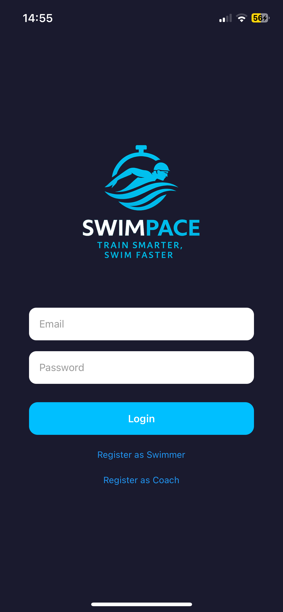<br><sub>Login (both roles)</sub></td>
    <td align="center">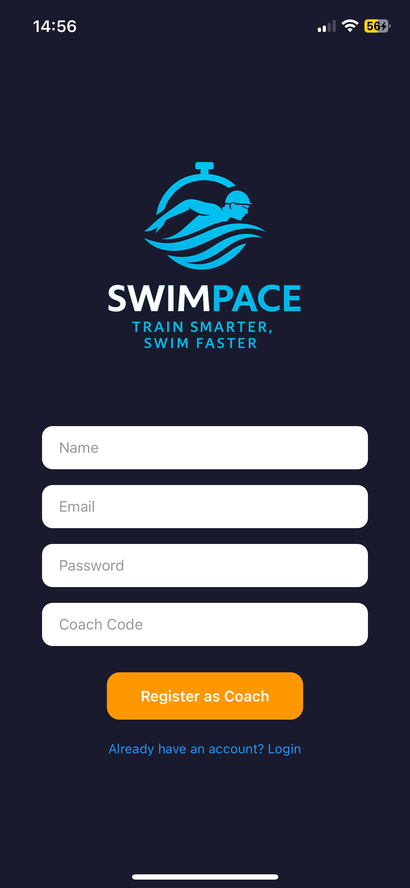<br><sub>Coach sign-up</sub></td>
    <td align="center">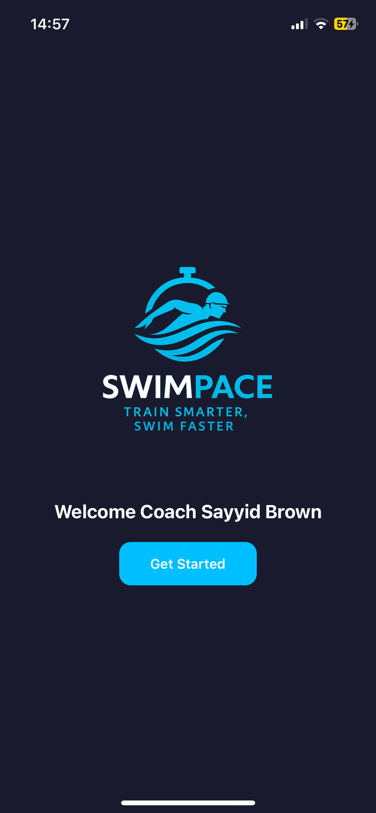<br><sub>Welcome</sub></td>
    <td align="center">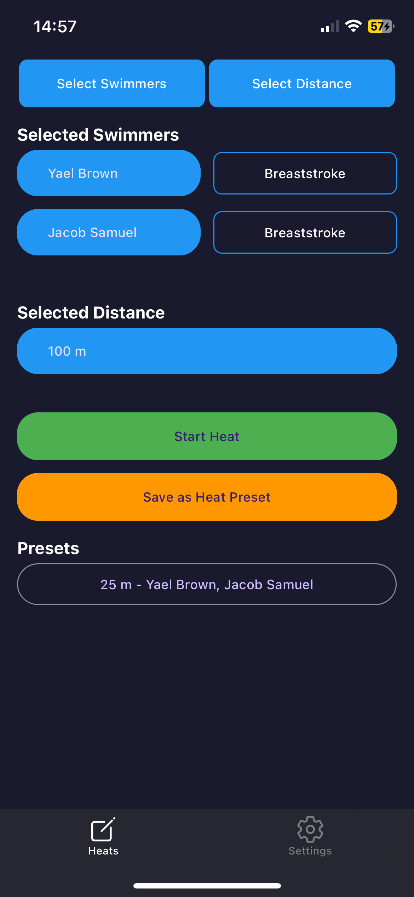<br><sub>Heat setup</sub></td>
  </tr>
  <tr>
    <td align="center">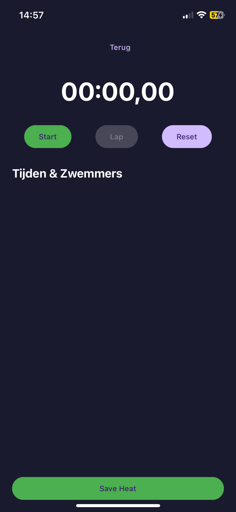<br><sub>Stopwatch</sub></td>
    <td align="center">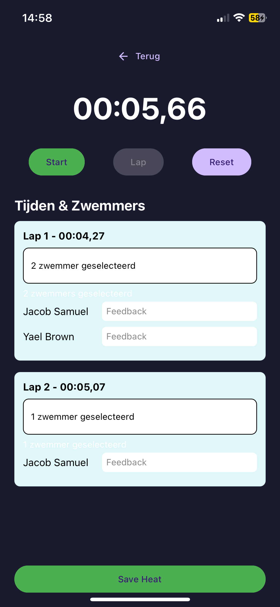<br><sub>Times and feedback</sub></td>
    <td align="center">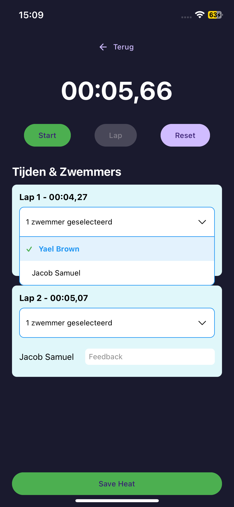<br><sub>Match times to swimmers</sub></td>
  </tr>
</table>

### Swimmer

<table>
  <tr>
    <td align="center">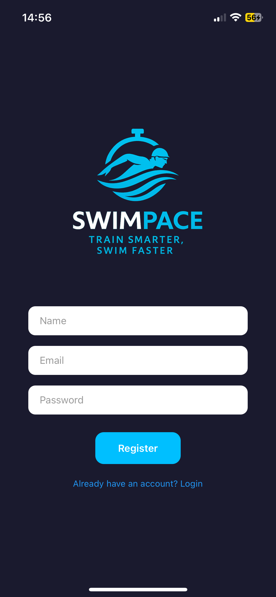<br><sub>Swimmer sign-up</sub></td>
    <td align="center">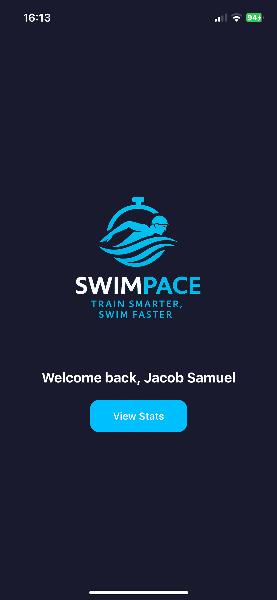<br><sub>Welcome</sub></td>
    <td align="center">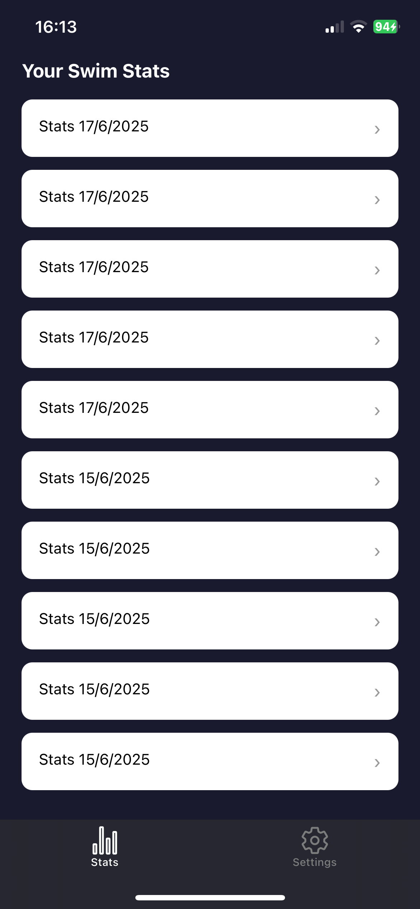<br><sub>Your Swim Stats</sub></td>
    <td align="center">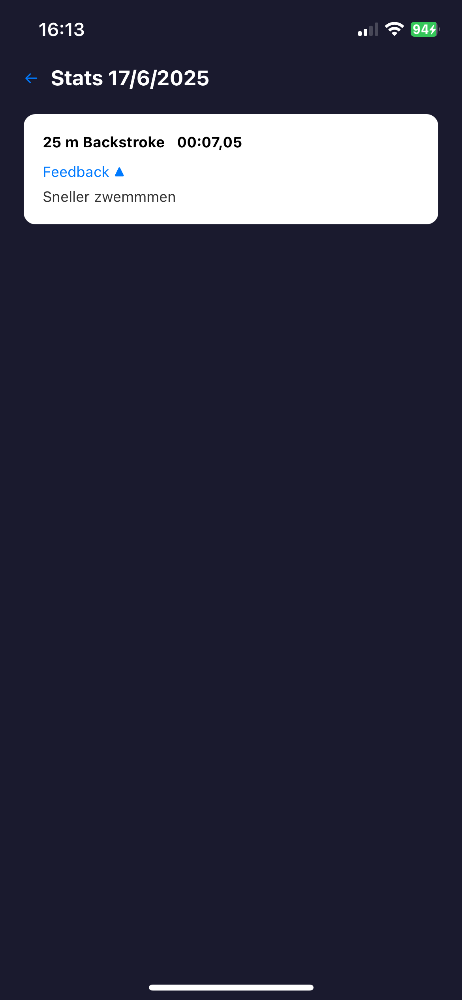<br><sub>Result details</sub></td>
  </tr>
</table>

## Built with

**App:** React Native (Expo), TypeScript, Expo Router, Firebase Authentication and Cloud Firestore, with a dark mode design.

**Website:** plain HTML and CSS in a single file. No framework, no build step, no dependencies. Hosted on GitHub Pages.

## Status

Swim Pace is not in the app stores yet. It is coming soon to the App Store and Google Play.

## My role

I designed and built Swim Pace on my own during my Creative Media and Game Technologies studies. I did the UX/UI design, the programming, the Firebase integration, user management and the timing logic.

## This repository

```
index.html   The whole one-pager: content and inline CSS
img/         App screenshots used on the page
```

To view the site locally, open `index.html` in a browser. Nothing needs to be installed. You can also serve the folder with any static server, for example `python3 -m http.server 8000`, and then visit http://localhost:8000.

GitHub Pages serves the live site from the root of the `main` branch, so every push to `main` updates it.

---

© 2025 Swim Pace – Sayyid Brown
